```{=html}
<div class="manual-title-row">
  <div class="manual-title-text">
    <h1 class="manual-title">Sistemas de Informação em Saúde Pública<br>| USP Baixo Vouga</h1>
    <p class="manual-subtitle">Manual Orientador</p>
  </div>
  
</div>
<div class="manual-meta-box">
  <span>👤 Autor: S. Leça</span>
  <span>📅 Criado em: 22 de junho de 2026</span>
  <span>🔄 Última atualização: 20 de outubro de 2026</span>
</div>
<hr/>
```

## Introdução {#sec-intro}

O projeto de intervenção **"Sistemas de Informação em Saúde Pública | USP Baixo Vouga"** visa a automatização de processos administrativos morosos e de reduzido valor acrescentado. O objetivo é otimizar a gestão do tempo dos profissionais da USP, permitindo a realocação do tempo libertado para funções e tarefas essenciais e de valor acrescentado para a prática em Saúde Pública. Paralelamente, este projeto corre em estreito alinhamento com o processo de certificação e melhoria contínua da USP.

Este manual atua como um guia de consulta para a transição e adaptação aos novos fluxos de trabalho. O [link](https://salomelecamd.github.io/sistemas_informacao_uspbv/) dá acesso à versão mais atualizada do manual, enquanto que os ficheiros HTML serão enviados via email apenas perante atualizações substanciais aos procedimentos.

## Programa de Vigilância Sanitária das Águas e Programa de Segurança Alimentar nas Cantinas {#sec-pvsa}

Encontramo-nos na fase de implementação do sistema de processamento automático dos boletins analíticos emitidos pelo INSA. A arquitetura deste sistema recorre ao **Power Automate** e ao **AI Builder** para ler os ficheiros PDF, extrair os resultados analíticos e registá-los de forma autónoma nas listas do SharePoint.

Durante a atual fase de testes, a validação rigorosa de todos os campos e a notificação de eventuais anomalias pelas equipas assumem um caráter crítico.

### O que muda com este sistema? {#sec-mudancas}

```{=html}
<table class="comparison-table">
  <thead>
    <tr>
      <th>⚠️ Processo Anterior (Manual)</th>
      <th>✅ Novo Processo (Automatizado)</th>
    </tr>
  </thead>
  <tbody>
    <tr>
      <td>
        <ol>
          <li>Receção do PDF com os resultados pela equipa gestora, via e-mail;</li>
          <li>Encaminhamento do PDF para a equipa local (EL);</li>
          <li>Abertura do ficheiro de resultados e inserção manual de cada parâmetro no Excel;</li>
          <li>Arquivo manual do documento PDF na pasta local respetiva.</li>
        </ol>
      </td>
      <td>
        <ol>
          <li>Processamento automático do e-mail proveniente do INSA;</li>
          <li>Extração estruturada de dados do boletim através do modelo de inteligência artificial;</li>
          <li>Classificação e arquivo automático do ficheiro no SharePoint;</li>
          <li>Registo automático dos campos dos boletins nas listas de resultados no SharePoint;</li>
          <li>Emissão de notificação automática para a EL.</li>
        </ol>
        <p class="action-note">→ <strong>Ação Manual:</strong> Verificação pelo TSA e preenchimento do campo "conclusão"</p>
      </td>
    </tr>
  </tbody>
</table>
```

### Fluxo de trabalho (Passo a Passo) {#sec-fluxo}

Sempre que um novo boletim analítico for remetido pelo INSA para a USP (usp.ulsra@ulsra.min-saude.pt), o sistema processa a informação e notifica a EL com os seguintes dados:

- Número do boletim;
- Concelho da colheita;
- Tipo de análise;
- Data de colheita;
- Hiperligação para o PDF do boletim;
- Hiperligação para a lista de resultados no SharePoint.

Os boletins (em PDF) são arquivados no SharePoint em pastas categorizadas por tipo de análise, transversais a todos os concelhos. A estrutura permite a aplicação de filtros (ex.: isolar boletins da Murtosa a 02/06/2026, ou por "ponto de colheita") para agilizar a pesquisa. O acesso pode ser efetuado através do e-mail de notificação ou diretamente na plataforma.

Os dados extraídos dos boletins são organizados e inseridos nas seguintes listas:

| Lista | Tipo de análise |
|---|---|
| `lista_ach` | Água de Consumo Humano (exclui pesquisa de Legionella) |
| `lista_legionella` | Água de Consumo Humano (pesquisa de Legionella) |
| `lista_piscinas` | Água de Piscina |
| `lista_amnn` | Águas Minerais Naturais e de Nascente |
| `lista_alimentos` | Alimentos (Confecionados e Crus) |
| `lista_zaragatoas` | Zaragatoas a Manipuladores e a Utensílios |

: Listas de resultados no SharePoint {.striped .hover}

Estas listas de resultados também podem ser acedidas de duas formas:

- Via email automático de notificação, clicando em "Ver registo de resultados na lista";
- Diretamente no SharePoint.

---

```{=html}
<div class="step-card">
  <div class="step-number">1</div>
  <div class="step-title">Receção da notificação por e-mail</div>
</div>
```

```{=html}
<div class="screenshot-box">
  <p class="screenshot-caption">📧 Exemplo de email recebido pela equipa local</p>
  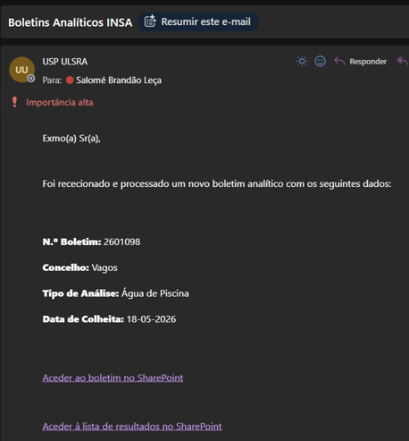
</div>
```

---

```{=html}
<div class="step-card">
  <div class="step-number">2</div>
  <div class="step-title">Aceder ao boletim</div>
</div>
```

```{=html}
<div class="video-grid">
  <a class="video-placeholder" href="https://snspt-my.sharepoint.com/:v:/g/personal/usp_ulsra_arscentro_min-saude_pt/IQAc36pZmmKyRpEaUmiEWrUzAeVJYLzJzHg1ADL5WzwgClo?nav=eyJyZWZlcnJhbEluZm8iOnsicmVmZXJyYWxBcHAiOiJPbmVEcml2ZUZvckJ1c2luZXNzIiwicmVmZXJyYWxBcHBQbGF0Zm9ybSI6IldlYiIsInJlZmVycmFsTW9kZSI6InZpZXciLCJyZWZlcnJhbFZpZXciOiJNeUZpbGVzTGlua0NvcHkifX0&e=hXBc1Q" target="_blank">
    🎬 Vídeo: acesso aos boletins pelo email de notificação
  </a>
  <a class="video-placeholder" href="https://snspt-my.sharepoint.com/:v:/g/personal/usp_ulsra_arscentro_min-saude_pt/IQCnh6-2Ux9zSYU-oWpSW0YwAdsXliYyfS71d0yvGMTDs8o?nav=eyJyZWZlcnJhbEluZm8iOnsicmVmZXJyYWxBcHAiOiJTdHJlYW1XZWJBcHAiLCJyZWZlcnJhbFZpZXciOiJTaGFyZURpYWxvZy1MaW5rIiwicmVmZXJyYWxBcHBQbGF0Zm9ybSI6IldlYiIsInJlZmVycmFsTW9kZSI6InZpZXcifX0%3D&e=PXJoaM" target="_blank">
    🎬 Vídeo: acesso aos boletins diretamente pelo SharePoint
  </a>
</div>
```

---

```{=html}
<div class="step-card">
  <div class="step-number">3</div>
  <div class="step-title">Aceder à lista de resultados no SharePoint</div>
</div>
```

```{=html}
<div class="video-grid">
  <a class="video-placeholder" href="https://snspt-my.sharepoint.com/:v:/g/personal/usp_ulsra_arscentro_min-saude_pt/IQC6dmxj_1p9RZzj8X4jN552Aa2hM7UACtkofMVE9XKexos?e=59WtfC&nav=eyJyZWZlcnJhbEluZm8iOnsicmVmZXJyYWxBcHAiOiJTdHJlYW1XZWJBcHAiLCJyZWZlcnJhbFZpZXciOiJTaGFyZURpYWxvZy1MaW5rIiwicmVmZXJyYWxBcHBQbGF0Zm9ybSI6IldlYiIsInJlZmVycmFsTW9kZSI6InZpZXcifX0%3D" target="_blank">
    🎬 Vídeo: acesso às listas pelo email de notificação
  </a>
</div>
```

---

```{=html}
<div class="step-card">
  <div class="step-number">4</div>
  <div class="step-title">Verificar os valores extraídos</div>
</div>
```

Aceder ao item gerado na lista e validar a correspondência dos dados com o PDF original, especificamente:

- Número do boletim (`n_boletim`)
- Identificador da colheita (`id_colheita`)
- Ponto de colheita
- Data da colheita
- Parâmetros analíticos

```{=html}
<div class="callout-test">
  <span class="callout-icon">⚠️</span>
  <div>
    <strong>Fase de Teste:</strong> É imperativo verificar a totalidade dos campos, mesmo que os valores pareçam corretos, para identificar padrões de erro no modelo de extração automática. Qualquer discrepância deve ser reportada (ver secção <a href="#sec-reporte">Reporte de Ocorrências</a>).
  </div>
</div>
```

```{=html}
<div class="video-grid">
  <a class="video-placeholder" href="https://snspt-my.sharepoint.com/:v:/g/personal/usp_ulsra_arscentro_min-saude_pt/IQAERL4E0NQQTJeFH8zaqZYbAWXlvfBcf7FKfoRqKfzYcpg?e=S75k1D&nav=eyJyZWZlcnJhbEluZm8iOnsicmVmZXJyYWxBcHAiOiJTdHJlYW1XZWJBcHAiLCJyZWZlcnJhbFZpZXciOiJTaGFyZURpYWxvZy1MaW5rIiwicmVmZXJyYWxBcHBQbGF0Zm9ybSI6IldlYiIsInJlZmVycmFsTW9kZSI6InZpZXcifX0%3D" target="_blank">
    🎬 Vídeo: verificação dos valores extraídos
  </a>
</div>
```

---

```{=html}
<div class="step-card">
  <div class="step-number">5</div>
  <div class="step-title">Preencher o campo de Conclusão</div>
</div>
```

Após a validação descrita no passo anterior, o campo **"conclusão"** tem de ser preenchido manualmente, selecionando entre as opções **"Cumpre/Não Cumpre"**. Esta ação consubstancia a avaliação final do boletim analítico, que cabe à EL realizar. O campo **"ofício_incumprimento"** deverá também ser preenchido manualmente.

```{=html}
<div class="video-grid">
  <a class="video-placeholder" href="https://snspt-my.sharepoint.com/:v:/g/personal/usp_ulsra_arscentro_min-saude_pt/IQB12UnFqMQFT7TQpAw0nLcCAVnnsqmz2c6byg5PulYvx3w?nav=eyJyZWZlcnJhbEluZm8iOnsicmVmZXJyYWxBcHAiOiJTdHJlYW1XZWJBcHAiLCJyZWZlcnJhbFZpZXciOiJTaGFyZURpYWxvZy1MaW5rIiwicmVmZXJyYWxBcHBQbGF0Zm9ybSI6IldlYiIsInJlZmVycmFsTW9kZSI6InZpZXcifX0%3D&e=1c1uGZ" target="_blank">
    🎬 Vídeo: preenchimento do campo de Conclusão
  </a>
</div>
```

### Situações Especiais {#sec-especiais}

#### Boletim retificado {#sec-retificado}

A receção de um boletim retificado (com número de relatório e ID de colheita iguais) espoleta a deteção de duplicação pelo sistema e a atualização do registo existente na lista de resultados com os novos valores. Todos os campos são substituídos, incluindo eventuais correções manuais já efetuadas no registo. O PDF original não é substituído, sendo conservado no arquivo.

**Procedimento:** Após a receção de nova notificação, confrontar o novo PDF com o registo atualizado, repetir as correções manuais que se mantenham necessárias e reavaliar o campo "Conclusão".

#### Boletim provisório {#sec-provisorio}

O boletim provisório é enviado pelo INSA, ainda incompleto, para permitir uma ação rápida da equipa local caso algum resultado não esteja conforme, sem ter de aguardar pelos resultados definitivos. Pode, por isso, apresentar parâmetros sem resultado, por a análise laboratorial ainda não estar concluída.

O boletim provisório é transcrito para a lista de resultados como qualquer outro boletim. A receção do boletim definitivo (com número de relatório e ID de colheita iguais) espoleta a deteção de duplicação pelo sistema e a atualização do registo existente com os novos valores, nos termos descritos em 2.3.1. Todos os campos são substituídos, incluindo eventuais correções manuais já efetuadas.

Para efeitos de registo e de histórico, deve ser considerado o boletim definitivo.

A distinção entre boletim provisório e definitivo é feita pela indicação presente no boletim (ver Figura X).

::: {.content-visible when-format="html"}
```{=html}
<div class="screenshot-box">
  <p class="screenshot-caption">📄 Distinção entre boletim definitivo e boletim provisório</p>
  <div style="display:grid; grid-template-columns:1fr 1fr; gap:1rem; padding:1rem;">
    <div>
      <p style="text-align:center; font-size:0.82rem; color:#555; margin-bottom:0.4rem;">Boletim Definitivo</p>
      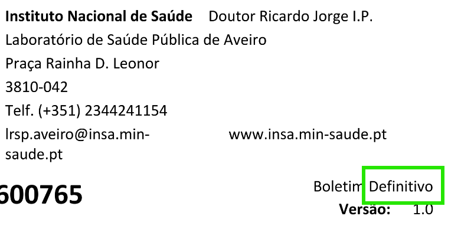
    </div>
    <div>
      <p style="text-align:center; font-size:0.82rem; color:#555; margin-bottom:0.4rem;">Boletim Provisório</p>
      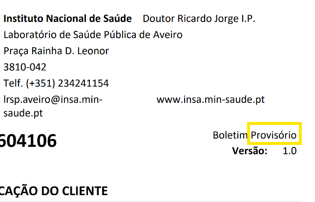
    </div>
  </div>
</div>
```
:::

**Procedimento:** Analisar o boletim provisório para identificação de resultados não conformes que exijam ação imediata. Não corrigir os valores transcritos: a verificação, a correção e a avaliação final do campo "Conclusão" devem ser efetuadas apenas após a receção do boletim definitivo.

#### Boletim de tipo não reconhecido {#sec-nao-reconhecido}

Caso o sistema não consiga categorizar o tipo de análise, o ficheiro é alocado à pasta `nao_identificado`, sem a criação de registo na lista ou notificação à equipa local. A monitorização destas ocorrências é realizada centralmente pela equipa gestora do programa, que receberá um email automático de notificação de ocorrência desta situação.

## Calendário Partilhado da USP {#sec-calendario}

Encontramo-nos na fase piloto do **Calendário Partilhado da USP Baixo Vouga**. O sistema reúne num só sítio o planeamento e o registo das atividades da Unidade, e assenta em quatro peças:

- uma aplicação **Power Apps**, onde cada profissional planeia e regista as suas atividades;
- fluxos do **Power Automate**, que criam os eventos nos calendários partilhados dos polos e equipas e enviam os convites aos participantes;
- listas do **SharePoint**, onde ficam guardadas todas as atividades;
- um relatório **Power BI**, que reúne as atividades realizadas para análise e para o Relatório de Atividades da USP.

Nesta fase participam os Serviços Locais de Estarreja, de Albergaria-a-Velha e de Vagos. As equipas (Equipa de Gestão e da Qualidade, Equipas Gestoras dos programas e Núcleo de Vacinação) serão integradas numa fase posterior.

```{=html}
<div class="callout-test">
  <span class="callout-icon">⚠️</span>
  <div>
    <strong>Fase Piloto:</strong> A aplicação contém algumas atividades de simulação, criadas apenas para teste. Qualquer comportamento inesperado (atividade que não aparece, evento que não chega ao calendário, número que não bate certo) deve ser reportado (ver secção <a href="#sec-reporte">Reporte de Ocorrências</a>).
  </div>
</div>
```

### O que muda com este sistema? {#sec-cal-mudancas}

```{=html}
<table class="comparison-table">
  <thead>
    <tr>
      <th>⚠️ Processo Anterior (Manual)</th>
      <th>✅ Novo Processo (Automatizado)</th>
    </tr>
  </thead>
  <tbody>
    <tr>
      <td>
        <ol>
          <li>Atividades planeadas em agendas pessoais, folhas Excel ou e-mails dispersos;</li>
          <li>Criação manual do evento no calendário do polo/equipa e envio individual dos convites;</li>
          <li>Pouca visibilidade sobre o que as outras equipas e polos estão a fazer;</li>
          <li>Contagem manual das atividades realizadas para o Relatório de Atividades.</li>
        </ol>
      </td>
      <td>
        <ol>
          <li>Registo de cada atividade na aplicação, com programa e tipo de atividade do catálogo da USP;</li>
          <li>Criação automática do evento no calendário da unidade e envio automático dos convites;</li>
          <li>Vista Global com todas as atividades da USP, com filtros e resumo em números;</li>
          <li>Importação da planificação anual a partir de um modelo Excel;</li>
          <li>Reunião automática das atividades realizadas no Power BI, pronta a extrair.</li>
        </ol>
        <p class="action-note">→ <strong>Ação Manual:</strong> Registo da atividade na aplicação e, depois da data, indicação do estado final (Realizada, Reagendada ou Cancelada)</p>
      </td>
    </tr>
  </tbody>
</table>
```

### Acesso à aplicação {#sec-cal-acesso}

A aplicação abre no navegador, através do [link da aplicação](https://apps.powerapps.com/play/e/default-22c84608-f01d-46c5-8024-63cc962e5f51/a/50d606a5-77cc-4e8b-a6ee-1ebd49de9840?tenantId=22c84608-f01d-46c5-8024-63cc962e5f51), com a conta institucional. Na primeira utilização pode surgir um pedido para permitir a ligação ao SharePoint: deve carregar em **Permitir**.

O ecrã inicial dá acesso a todas as funcionalidades. No canto inferior esquerdo aparece a versão da aplicação (por exemplo, "v0.10.0-beta · build 44"), útil para indicar ao reportar uma ocorrência.

```{=html}
<div class="screenshot-box">
  <p class="screenshot-caption">🏠 Ecrã inicial da aplicação</p>
  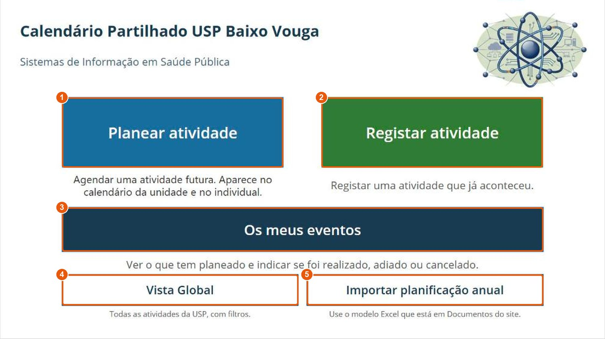
  <ol class="legend-list">
    <li><span><strong>Planear atividade:</strong> para atividades futuras. Cria o evento no calendário da unidade e envia convite aos participantes.</span></li>
    <li><span><strong>Registar atividade:</strong> para atividades que já aconteceram e não foram planeadas na aplicação.</span></li>
    <li><span><strong>Os meus eventos:</strong> as atividades em que participa ou que organizou, e as que estão por fechar.</span></li>
    <li><span><strong>Vista Global:</strong> todas as atividades da USP, com filtros e resumo em números.</span></li>
    <li><span><strong>Importar planificação anual:</strong> abre a biblioteca onde se carrega o modelo Excel preenchido.</span></li>
  </ol>
</div>
```

```{=html}
<div class="callout-info">
  <span class="callout-icon">💡</span>
  <div>
    <strong>Planear ou Registar?</strong> Se a atividade ainda vai acontecer, use <strong>Planear atividade</strong>. Se já aconteceu e não foi planeada, use <strong>Registar atividade</strong>. Uma atividade planeada não deve voltar a ser registada: basta marcá-la como Realizada em "Os meus eventos" (ver <a href="#sec-cal-fechar">Fechar uma atividade</a>).
  </div>
</div>
```

### Planear uma atividade (Passo a Passo) {#sec-cal-planear}

```{=html}
<div class="step-card">
  <div class="step-number">1</div>
  <div class="step-title">Abrir o formulário "Planear atividade"</div>
</div>
```

No ecrã inicial, carregar em **Planear atividade**. Os campos assinalados com asterisco (*) são obrigatórios.

```{=html}
<div class="screenshot-box">
  <p class="screenshot-caption">📝 Formulário "Planear atividade"</p>
  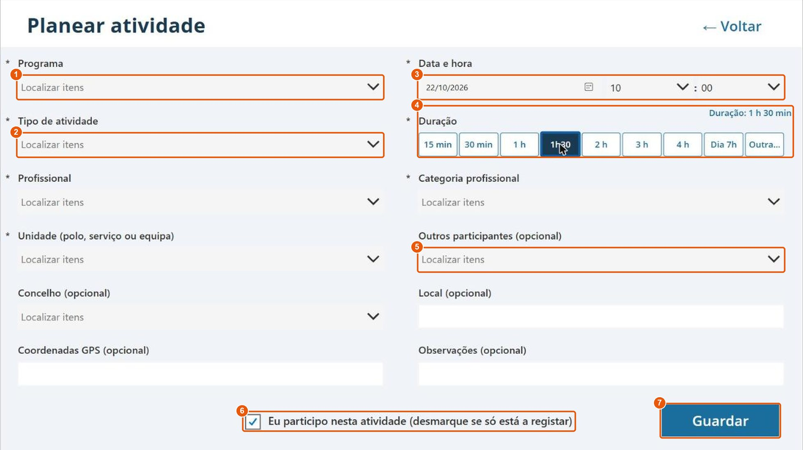
  <ol class="legend-list">
    <li><span><strong>Programa:</strong> escolher primeiro o programa ou área de intervenção.</span></li>
    <li><span><strong>Tipo de atividade:</strong> mostra apenas os tipos do programa escolhido (ver passo 2).</span></li>
    <li><span><strong>Data e hora:</strong> tem de ser uma data futura.</span></li>
    <li><span><strong>Duração (minutos):</strong> tempo previsto da atividade.</span></li>
    <li><span><strong>Outros participantes:</strong> colegas que também participam. Cada um recebe convite no seu calendário.</span></li>
    <li><span><strong>Eu participo nesta atividade:</strong> vem marcado. Desmarcar se está apenas a registar uma atividade de colegas (ver <a href="#sec-cal-especiais">Situações Especiais</a>).</span></li>
    <li><span><strong>Guardar:</strong> grava a atividade e volta ao ecrã inicial.</span></li>
  </ol>
</div>
```

---

```{=html}
<div class="step-card">
  <div class="step-number">2</div>
  <div class="step-title">Escolher o programa e o tipo de atividade</div>
</div>
```

Os programas e os tipos de atividade vêm do **catálogo de atividades da USP**, construído a partir do Relatório de Atividades e validado pelas equipas de cada programa. Depois de escolhido o programa, a lista do tipo de atividade mostra apenas os tipos desse programa, seguidos dos tipos **transversais** (reuniões, formação, apoio administrativo), comuns a todos os programas. É possível escrever parte do nome para filtrar a lista.

```{=html}
<div class="screenshot-box">
  <p class="screenshot-caption">🔎 O tipo de atividade depende do programa escolhido</p>
  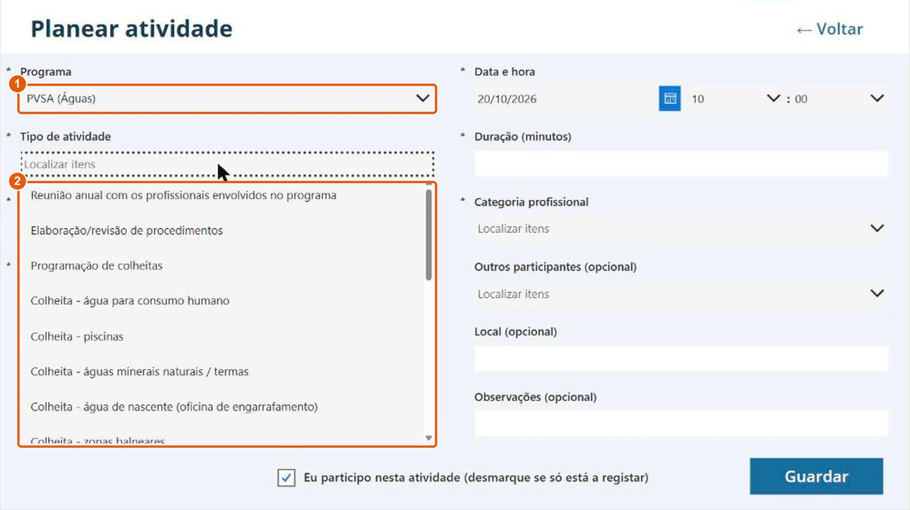
  <ol class="legend-list">
    <li><span>Programa escolhido (neste exemplo, PVSA (Águas)).</span></li>
    <li><span>Tipos de atividade disponíveis para esse programa.</span></li>
  </ol>
</div>
```

---

```{=html}
<div class="step-card">
  <div class="step-number">3</div>
  <div class="step-title">Completar os restantes campos e guardar</div>
</div>
```

Indicar o **profissional**, a **categoria profissional** e a **unidade** (polo, serviço ou equipa) cujo calendário recebe o evento. O concelho, o local, as coordenadas GPS e as observações são opcionais, mas ajudam a contextualizar a atividade e a analisá-la mais tarde. Carregar em **Guardar**.

---

```{=html}
<div class="step-card">
  <div class="step-number">4</div>
  <div class="step-title">Confirmar o evento no calendário</div>
</div>
```

Alguns instantes depois de guardar, o sistema cria o evento no **calendário partilhado da unidade** e envia o convite a cada participante, que o vê no seu calendário do Outlook. A atividade fica com o estado **Planeada** e aparece em "Os meus eventos" de cada participante.

### Registar uma atividade já realizada {#sec-cal-registar}

O formulário **Registar atividade** é igual ao de planeamento, com duas diferenças:

- a data e hora não pode ser futura;
- a atividade fica logo com o estado **Realizada**.

```{=html}
<div class="screenshot-box">
  <p class="screenshot-caption">✅ Formulário "Registar atividade"</p>
  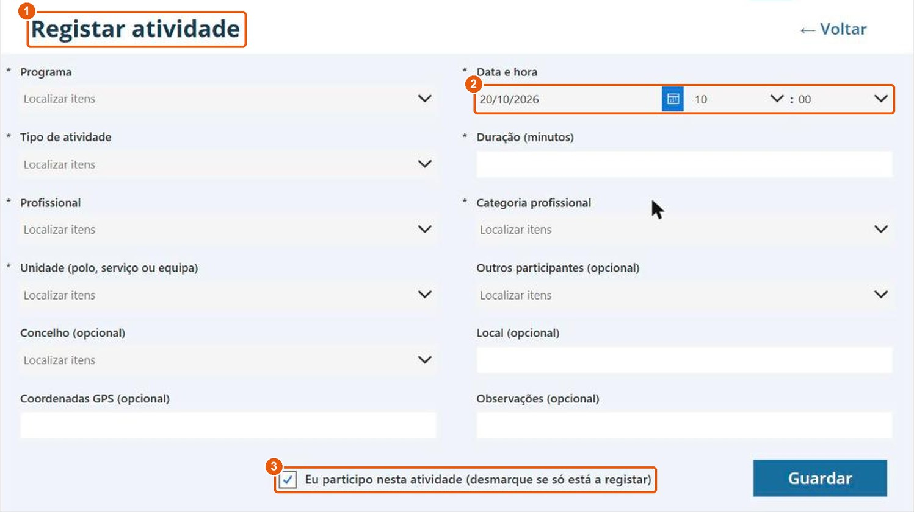
  <ol class="legend-list">
    <li><span>O título confirma que está a registar uma atividade já realizada.</span></li>
    <li><span><strong>Data e hora:</strong> a data em que a atividade aconteceu (hoje ou anterior).</span></li>
    <li><span><strong>Eu participo nesta atividade:</strong> desmarcar se está apenas a registar uma atividade realizada por colegas e, nesse caso, indicar os participantes.</span></li>
  </ol>
</div>
```

```{=html}
<div class="callout-info">
  <span class="callout-icon">💡</span>
  <div>
    <strong>O registo não cria evento no calendário:</strong> como a atividade já aconteceu, não é criado evento no calendário da unidade nem são enviados convites. Ainda assim, a atividade fica gravada: aparece a verde em "Os meus eventos" de cada participante, aparece na Vista Global e é contabilizada no Power BI como atividade realizada.
  </div>
</div>
```

### Os meus eventos {#sec-cal-meus}

Este ecrã mostra, em calendário, as atividades em que participa ou que organizou. As cores indicam o estado de cada atividade.

```{=html}
<div class="screenshot-box">
  <p class="screenshot-caption">📅 Ecrã "Os meus eventos" (vista mensal)</p>
  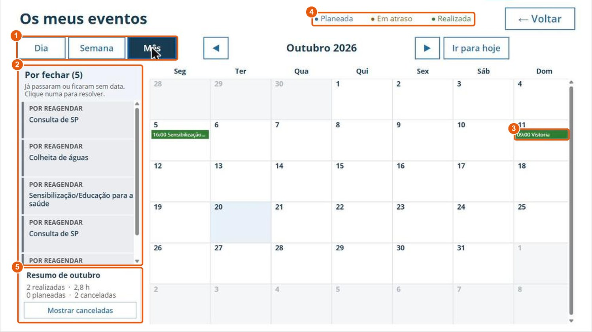
  <ol class="legend-list">
    <li><span><strong>Dia / Semana / Mês:</strong> muda a vista do calendário. As setas e "Ir para hoje" navegam entre períodos.</span></li>
    <li><span><strong>Por fechar:</strong> atividades cuja data já passou e ainda não têm estado final, ou que ficaram por reagendar. Clicar numa para a resolver.</span></li>
    <li><span>Atividade realizada (a verde). Clicar numa atividade abre o respetivo detalhe.</span></li>
    <li><span><strong>Legenda de cores:</strong> azul = planeada; laranja = em atraso; verde = realizada.</span></li>
    <li><span><strong>Resumo do mês:</strong> número de atividades realizadas, horas, planeadas e canceladas. "Mostrar canceladas" faz aparecer também as canceladas.</span></li>
  </ol>
</div>
```

#### Fechar uma atividade {#sec-cal-fechar}

Depois da data da atividade, é necessário indicar o que aconteceu. Ao clicar numa atividade **por fechar**, abre-se a janela de detalhe com as opções disponíveis:

```{=html}
<div class="screenshot-box">
  <p class="screenshot-caption">🗂️ Detalhe de uma atividade por fechar</p>
  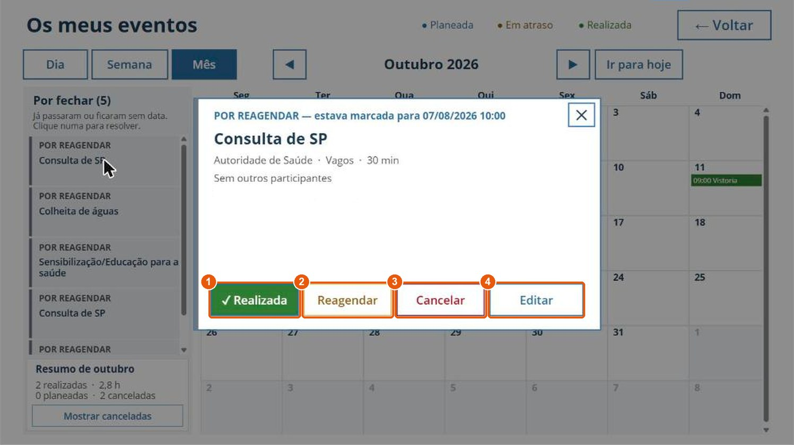
  <ol class="legend-list">
    <li><span><strong>Realizada:</strong> a atividade aconteceu. Passa a verde e conta como realizada no Power BI.</span></li>
    <li><span><strong>Reagendar:</strong> a atividade foi adiada. Indicar a nova data, ou escolher "Ainda não sei a nova data"; neste caso fica em "Por reagendar" até ser escolhida a data.</span></li>
    <li><span><strong>Cancelar:</strong> a atividade não se vai realizar. O evento é cancelado no calendário da unidade.</span></li>
    <li><span><strong>Editar:</strong> corrigir dados da atividade (duração, tipo, participantes, local, etc.). A data e a hora só podem ser mudadas aqui durante um período curto (ver <a href="#sec-cal-data">Mudar a data de uma atividade</a>).</span></li>
  </ol>
</div>
```

**Basta um participante fechar a atividade:** o estado muda para todos os participantes e o calendário é atualizado. Fica registado quem alterou o estado e quando. Depois de uma atividade estar Realizada ou Cancelada, os botões de estado deixam de aparecer e resta apenas a opção **Editar**, para correções.

```{=html}
<div class="screenshot-box">
  <p class="screenshot-caption">✔️ Detalhe de uma atividade já realizada</p>
  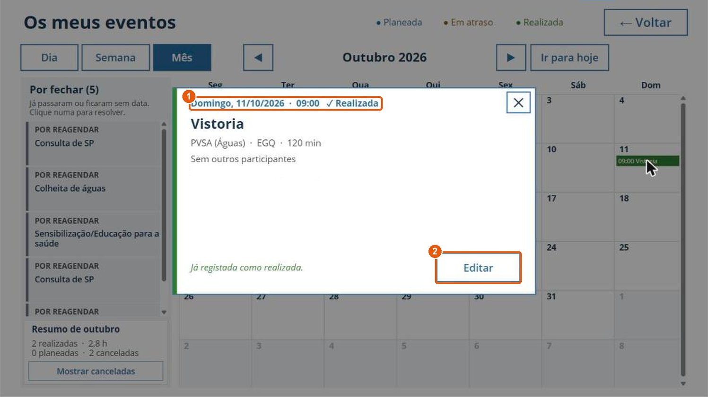
  <ol class="legend-list">
    <li><span>Data, hora e estado atual da atividade.</span></li>
    <li><span><strong>Editar:</strong> continua disponível para corrigir um registo.</span></li>
  </ol>
</div>
```

```{=html}
<div class="callout-test">
  <span class="callout-icon">⏰</span>
  <div>
    <strong>Lembrete diário:</strong> quem tiver atividades em atraso ou por reagendar recebe um e-mail de resumo com essas atividades. Para deixar de o receber, basta fechá-las em "Os meus eventos".
  </div>
</div>
```

### Vista Global {#sec-cal-global}

A Vista Global mostra **todas as atividades da USP**. Cada atividade aparece uma única vez, mesmo que tenha vários participantes. Cada profissional pode alterar as atividades em que participa ou que organizou. Além disso:

- a **Coordenação** pode alterar todas as atividades;
- o **coordenador dos TSA** (José Manuel Cerdeira) pode alterar as atividades em que participa algum TSA;
- a **coordenadora dos Enfermeiros** (Carmen Santos) pode alterar as atividades em que participa algum Enfermeiro de Saúde Pública.

Numa atividade com profissionais das duas categorias, ambos os coordenadores a podem alterar.

```{=html}
<div class="screenshot-box">
  <p class="screenshot-caption">🌐 Vista Global (separador Calendário)</p>
  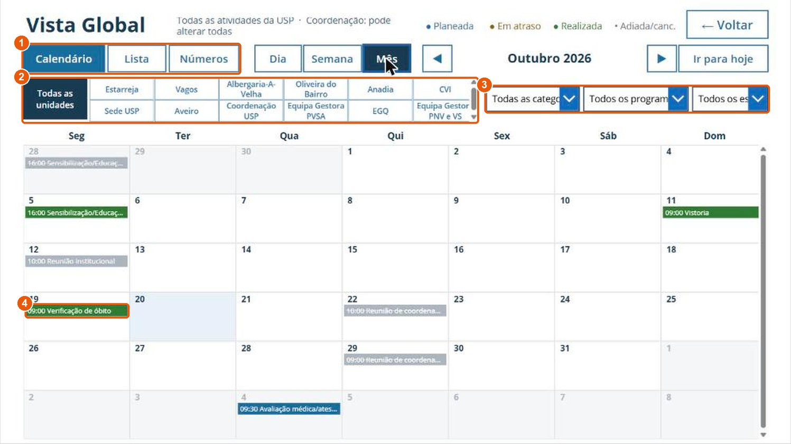
  <ol class="legend-list">
    <li><span><strong>Calendário / Lista / Números:</strong> três formas de ver as mesmas atividades.</span></li>
    <li><span><strong>Filtro por unidade:</strong> "Todas as unidades" ou um polo, serviço ou equipa.</span></li>
    <li><span><strong>Filtros adicionais:</strong> categoria profissional, programa e estado.</span></li>
    <li><span>Exemplo de atividade criada com "Registar atividade": aparece na Vista Global, a verde, sem ter gerado evento no calendário.</span></li>
  </ol>
</div>
```

```{=html}
<div class="screenshot-box">
  <p class="screenshot-caption">📋 Vista Global (separador Lista)</p>
  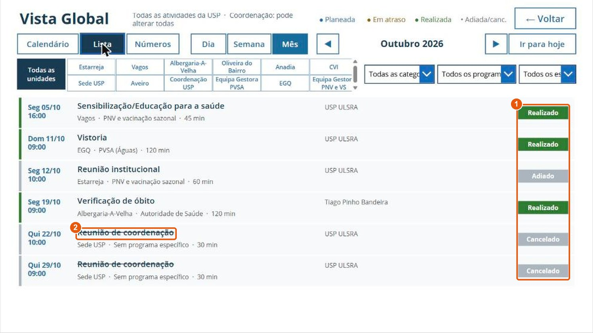
  <ol class="legend-list">
    <li><span>Estado de cada atividade (Realizado, Adiado, Cancelado, Planeado).</span></li>
    <li><span>As atividades canceladas aparecem riscadas.</span></li>
  </ol>
</div>
```

```{=html}
<div class="screenshot-box">
  <p class="screenshot-caption">📊 Vista Global (separador Números)</p>
  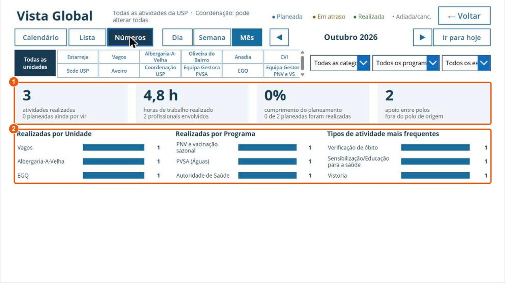
  <ol class="legend-list">
    <li><span>Indicadores do período e dos filtros escolhidos: atividades realizadas, horas, cumprimento do planeamento e apoio entre polos.</span></li>
    <li><span>Atividades realizadas por unidade, por programa e tipos de atividade mais frequentes.</span></li>
  </ol>
</div>
```

```{=html}
<div class="callout-info">
  <span class="callout-icon">💡</span>
  <div>
    <strong>Período disponível:</strong> para se manter rápida, a Vista Global carrega os últimos 180 dias e todas as atividades futuras. Os dados mais antigos não são apagados: continuam disponíveis no Power BI (ver <a href="#sec-cal-powerbi">Power BI</a>).
  </div>
</div>
```

### Importar a planificação anual {#sec-cal-importar}

As equipas que já têm o plano anual das suas atividades (por exemplo, o calendário de colheitas) podem importá-lo de uma só vez, em vez de planear atividade a atividade. O mesmo ficheiro pode incluir atividades já realizadas este ano: as linhas com data passada são registadas como **Realizadas**, sem evento no calendário nem convite, tal como em "Registar atividade".

```{=html}
<div class="step-card">
  <div class="step-number">1</div>
  <div class="step-title">Descarregar o modelo Excel</div>
</div>
```

O [modelo da planificação anual](https://snspt.sharepoint.com/sites/USPBaixoVouga-piloto_calendario_partilhado/Documentos%20Partilhados/Modelo%20-%20Planifica%C3%A7%C3%A3o%20anual.xlsx) está em **Documentos** no site do piloto. Deve ser guardada uma cópia, mantendo o modelo original intacto.

```{=html}
<div class="screenshot-box">
  <p class="screenshot-caption">📗 Modelo Excel da planificação anual</p>
  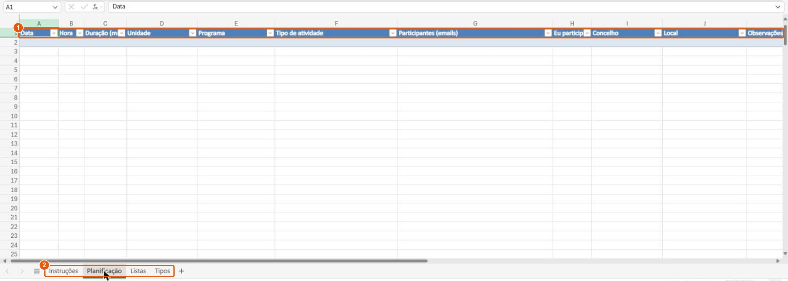
  <ol class="legend-list">
    <li><span>Colunas da tabela "Atividades", a preencher uma linha por atividade. Os nomes das colunas não podem ser alterados.</span></li>
    <li><span>Folhas do modelo: <strong>Instruções</strong>, <strong>Planificação</strong> (a preencher), <strong>Listas</strong> e <strong>Tipos</strong> (valores das listas de escolha; não alterar).</span></li>
  </ol>
</div>
```

---

```{=html}
<div class="step-card">
  <div class="step-number">2</div>
  <div class="step-title">Preencher a folha "Planificação"</div>
</div>
```

Cada linha corresponde a uma atividade numa data. Uma colheita mensal ocupa, por isso, 12 linhas. A Unidade, o Programa, o Tipo de atividade, o Concelho e o "Eu participo" escolhem-se em listas: tal como na aplicação, **o Tipo de atividade só mostra os tipos do Programa escolhido** nessa linha, mais os transversais.

| Coluna | Preenchimento |
|---|---|
| Data | Obrigatório. dd/mm/aaaa. Datas futuras ficam Planeadas; datas passadas ficam registadas como Realizadas. |
| Hora | Obrigatório. hh:mm (ex.: 09:30). |
| Duração (min) | Opcional. Vazio = 60 minutos. |
| Unidade | Obrigatório. Unidade cujo calendário recebe o evento. |
| Programa | Obrigatório. Escolher primeiro o programa. |
| Tipo de atividade | Obrigatório. Tem de pertencer ao programa indicado (ou ser transversal). |
| Participantes (emails) | Emails institucionais separados por `;`, sem incluir o próprio. |
| Eu participo | "Não" se só está a organizar. Vazio = Sim. |
| Concelho, Local, Observações | Opcionais. |

: Preenchimento do modelo da planificação anual {.striped .hover}

Exemplo de linha preenchida:

| Data | Hora | Duração | Unidade | Programa | Tipo de atividade | Participantes | Eu participo | Concelho | Local |
|---|---|---|---|---|---|---|---|---|---|
| 03/11/2026 | 09:30 | 90 | Vagos | PVSA (Águas) | Colheita - água para consumo humano | nome.apelido@ulsra.min-saude.pt | Sim | Vagos | ETAR Vagos |

: Exemplo de uma atividade na planificação anual {.striped}

---

```{=html}
<div class="step-card">
  <div class="step-number">3</div>
  <div class="step-title">Carregar o ficheiro na biblioteca "Planificação anual"</div>
</div>
```

No ecrã inicial da aplicação, carregar em **Importar planificação anual**. Abre-se a biblioteca "Planificação anual" do SharePoint, onde se carrega o ficheiro preenchido.

```{=html}
<div class="screenshot-box">
  <p class="screenshot-caption">📂 Biblioteca "Planificação anual" no SharePoint</p>
  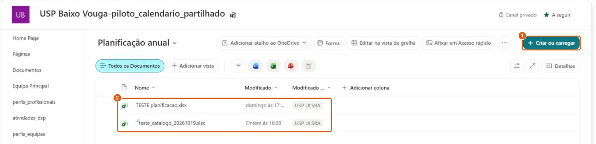
  <ol class="legend-list">
    <li><span><strong>Criar ou carregar:</strong> carregar o ficheiro Excel preenchido (também é possível arrastar o ficheiro para a lista).</span></li>
    <li><span>Ficheiros já carregados.</span></li>
  </ol>
</div>
```

---

```{=html}
<div class="step-card">
  <div class="step-number">4</div>
  <div class="step-title">Validar o resumo recebido por e-mail</div>
</div>
```

Poucos minutos depois de carregar o ficheiro, quem o carregou recebe um e-mail com o resumo da importação. **Nada é criado antes da aprovação.**

```{=html}
<div class="screenshot-box">
  <p class="screenshot-caption">📧 E-mail de validação da importação</p>
  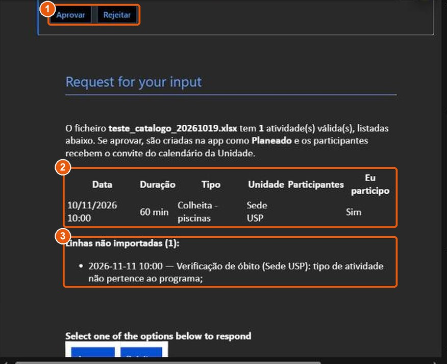
  <ol class="legend-list">
    <li><span><strong>Aprovar:</strong> as atividades de data futura são criadas como Planeadas e os participantes recebem o convite; as de data passada ficam registadas como Realizadas, sem convite. <strong>Rejeitar:</strong> nada é criado.</span></li>
    <li><span>Atividades válidas, que serão criadas se aprovar. A coluna "Fica como" indica se cada uma fica Planeada ou Realizada (data passada).</span></li>
    <li><span><strong>Linhas não importadas</strong>, com o motivo de cada uma (neste exemplo, um tipo de atividade que não pertence ao programa indicado).</span></li>
  </ol>
</div>
```

As linhas com erro não impedem a importação das restantes. Para as aproveitar, corrigir essas linhas e carregar um novo ficheiro só com elas. Carregar o mesmo ficheiro outra vez não duplica as atividades já importadas.

**Motivos mais frequentes de recusa de uma linha:**

- Data inválida;
- Hora fora do formato hh:mm;
- Unidade ou programa desconhecido;
- Tipo de atividade que não pertence ao programa indicado;
- Email de participante sem perfil na aplicação;
- "Eu participo" = Não sem outros participantes indicados;
- Atividade já importada anteriormente.

### Power BI {#sec-cal-powerbi}

O [relatório Power BI](https://app.powerbi.com/groups/me/reports/bd7b052b-7195-4d46-a034-77ca22374388) reúne as atividades registadas na aplicação, sem limite de período, para análise e para a elaboração do Relatório de Atividades da USP. Se o Power BI pedir uma licença, escolher a avaliação gratuita de 60 dias.

```{=html}
<div class="screenshot-box">
  <p class="screenshot-caption">📈 Relatório Power BI "Calendário USP - Atividades"</p>
  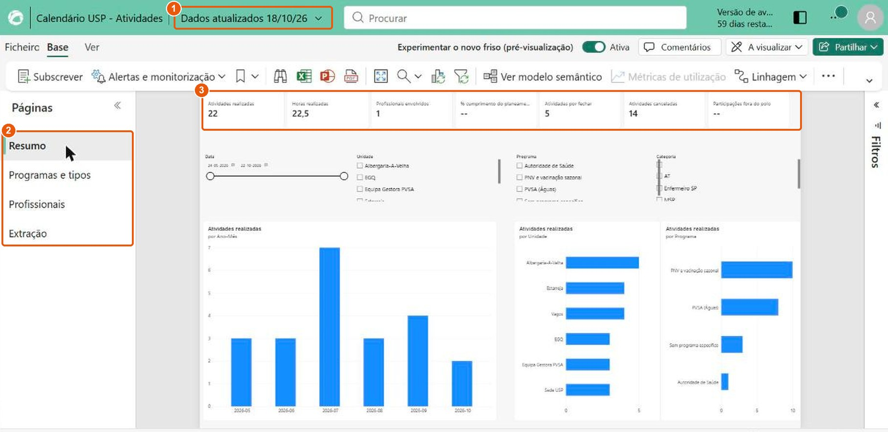
  <ol class="legend-list">
    <li><span>Data da última atualização dos dados do relatório.</span></li>
    <li><span><strong>Páginas:</strong> Resumo, Programas e tipos, Profissionais e Extração.</span></li>
    <li><span>Indicadores principais, que respondem aos filtros de data, unidade, programa e categoria.</span></li>
  </ol>
</div>
```

Para extrair os dados, abrir a página **Extração** e, na tabela, escolher **⋯ → Exportar dados**: é gerado um ficheiro Excel com as atividades filtradas. O relatório completo pode ser exportado em PDF ou PowerPoint em **Exportar**, na barra superior.

```{=html}
<div class="callout-info">
  <span class="callout-icon">💡</span>
  <div>
    <strong>Quem regista nem sempre participa:</strong> no Power BI e na Vista Global, as horas e as participações contam apenas os profissionais que participaram na atividade. A atividade conta sempre uma vez como realizada.
  </div>
</div>
```

### Situações Especiais {#sec-cal-especiais}

#### Registar uma atividade em que não participa {#sec-cal-nao-participa}

Desmarcar **"Eu participo nesta atividade"** e indicar os colegas em **Outros participantes**. Quem regista não recebe convite nem conta nas horas ou participações, mas continua a ver a atividade em "Os meus eventos" para a poder fechar, reagendar ou cancelar.

#### Atividade com vários participantes {#sec-cal-varios}

Todos os participantes veem a atividade em "Os meus eventos" e podem fechá-la. Assim que um deles indica o estado final, este é aplicado a todos, e fica registado quem o fez e quando. Não é necessário que cada participante feche a atividade.

#### Atividade adiada sem nova data {#sec-cal-adiada}

Em **Reagendar**, escolher "Ainda não sei a nova data". A atividade fica em **Por reagendar** na lista "Por fechar" de "Os meus eventos" até ser escolhida a nova data.

#### Corrigir um registo {#sec-cal-corrigir}

Abrir a atividade em "Os meus eventos" ou na Vista Global e carregar em **Editar**. Esta opção mantém-se disponível depois de a atividade estar realizada. A data e a hora seguem a regra descrita a seguir.

#### Mudar a data de uma atividade {#sec-cal-data}

Para que todas as mudanças de data fiquem registadas, a data e a hora só podem ser alteradas em **Editar** durante um período curto:

- **No dia em que a atividade é criada**, para corrigir enganos;
- **Atividades importadas da planificação anual:** durante os **7 dias** seguintes à importação.

Depois disso, no ecrã "Editar atividade", a data e a hora aparecem a cinzento, com a nota **"🔒 Para mudar a data, use Adiar."** Os restantes campos (local, observações, participantes, concelho, etc.) continuam editáveis.

Para mudar a data a partir daí, usar **Reagendar** no detalhe da atividade (ver <a href="#sec-cal-fechar">Fechar uma atividade</a>). A mudança fica registada nas atividades adiadas. A Coordenação pode mudar a data e a hora em qualquer altura.

#### O meu nome não aparece na lista de profissionais {#sec-cal-perfil}

A aplicação usa a lista de perfis dos profissionais da USP. Se o seu nome, ou o de um colega, não aparecer como Profissional ou em Outros participantes, reportar a situação (ver secção <a href="#sec-reporte">Reporte de Ocorrências</a>).

## Reporte de Ocorrências {#sec-reporte}

Os sistemas de informação com automatizações não são infalíveis. É essencial que qualquer problema ou incongruência detetada seja comunicada para que seja possível corrigir e melhorar o sistema.

**Ocorrências a reportar:**

*Boletins analíticos (PVSA e PSAC):*

- Extração incorreta de valores (ex.: erro no pH ou parâmetro inserido na coluna errada);
- Campos vazios no SharePoint que constem no boletim em PDF;
- Incorreções na identificação do ponto ou da data de colheita;
- Receção de boletim sem a respetiva notificação por e-mail ou omissão de registo na lista.

*Calendário Partilhado:*

- Atividade planeada sem o respetivo evento no calendário da unidade, ou convite que não chegou a um participante;
- Atividade que não aparece em "Os meus eventos" ou na Vista Global;
- Programa ou tipo de atividade em falta no catálogo, ou que não corresponde à atividade real;
- Profissional que não aparece na lista de profissionais ou de participantes;
- Números da Vista Global ou do Power BI que não correspondem às atividades registadas;
- Mensagens de erro na aplicação.

*Geral:*

- Qualquer comportamento atípico do sistema de informação.

**Práticas a evitar:**

- Alterar diretamente os dados incorretos na lista sem reportar o erro;
- Assumir falhas de extração como exceções irrelevantes ou pontuais;
- Ignorar omissões de preenchimento nas listas de resultados em campos que deviam estar preenchidos;
- Registar de novo uma atividade que já tinha sido planeada, em vez de a marcar como Realizada.

**Enviar email nos seguintes moldes:**

| Contacto | Informação |
|---|---|
| Para: | sbleca@ulsra.min-saude.pt |
| CC (sempre): | usp.ulsra@ulsra.min-saude.pt ; equipa gestora do programa em que ocorreu o erro |
| Assunto sugerido | Problema – Sistemas de Informação em Saúde Pública |
| Corpo do e-mail: | Identificação do sistema (boletins analíticos ou Calendário Partilhado) e do programa (ex.: PVSA, PSAC, etc.); número do boletim (`n_boletim`) ou data, unidade e tipo da atividade, se aplicável; descrição sucinta da anomalia (ex.: valor extraído pelo sistema vs. valor real no boletim; evento que não chegou ao calendário). Se possível, juntar uma captura de ecrã. |

: Template de email para reporte de ocorrências {.striped}

## Acessos rápidos {#sec-ref}

| Recurso | Endereço / Informação |
|---|---|
| Manual atualizado | [https://salomelecamd.github.io/sistemas_informacao_uspbv/](https://salomelecamd.github.io/sistemas_informacao_uspbv/) |
| Site SharePoint USP | [https://snspt.sharepoint.com/sites/ARSC-ACESBV-USPBaixoVouga](https://snspt.sharepoint.com/sites/ARSC-ACESBV-USPBaixoVouga) |
| Calendário Partilhado (aplicação) | [Abrir a aplicação](https://apps.powerapps.com/play/e/default-22c84608-f01d-46c5-8024-63cc962e5f51/a/50d606a5-77cc-4e8b-a6ee-1ebd49de9840?tenantId=22c84608-f01d-46c5-8024-63cc962e5f51) |
| Calendário Partilhado (Power BI) | [Abrir o relatório](https://app.powerbi.com/groups/me/reports/bd7b052b-7195-4d46-a034-77ca22374388) |
| Modelo da planificação anual | [Descarregar o modelo Excel](https://snspt.sharepoint.com/sites/USPBaixoVouga-piloto_calendario_partilhado/Documentos%20Partilhados/Modelo%20-%20Planifica%C3%A7%C3%A3o%20anual.xlsx) |
| Biblioteca da planificação anual | [Carregar a planificação](https://snspt.sharepoint.com/sites/USPBaixoVouga-piloto_calendario_partilhado/planificacao_anual/Forms/AllItems.aspx) |
| E-mail do projeto | usp.ulsra@ulsra.min-saude.pt |
| Suporte técnico | sbleca@ulsra.min-saude.pt |

: Acessos rápidos {.striped .hover}

---

```{=html}
<p class="closing-note">Obrigada pela colaboração.</p>
```
